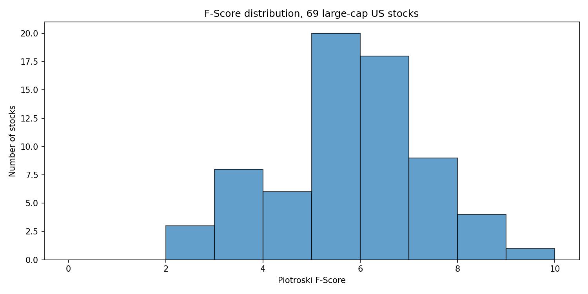
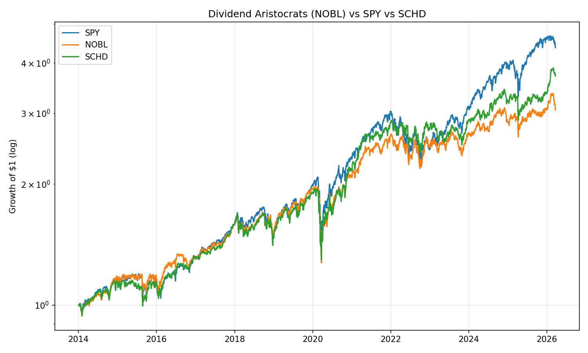

# Paper Screens

**From financial statements to interpretable stock screens.**

Paper Screens turns fundamental investing ideas into Python examples: score a balance sheet, compare profitability, look for accounting signals, and combine measures into a composite. The project includes ten individual and composite screens plus a signal-parity example that brings price and fundamental signals together.

## Results in pictures

### Piotroski F-score: a distribution of fundamentals



This archived run plots the F-scores calculated for **69 US large-cap stocks**. Most observations cluster around five and six on the 0–9 score. The chart shows a cross-sectional snapshot, not the performance of an investment strategy. Missing financial-statement fields can affect a score and should be checked before interpreting it.

### Dividend funds compared with the market



The example compares SPY, NOBL, and SCHD from 2014 through the snapshot period. In this run, SPY ended above both dividend-focused funds. The comparison is limited to these funds and this period; it is not a test of every dividend strategy.

The figures are archived outputs from **March 2026**, generated from matching versions of the published scripts. The underlying Yahoo Finance data snapshot is not included, so exact independent reproduction has not been verified. The scripts use simplified assumptions and do not consistently include transaction costs; data and outputs change over time.

## Screens and examples

| # | Screen | What the code examines |
|---|---|---|
| 01 | [Piotroski F-score](ch01_piotroski_fscore.py) | Nine profitability, balance-sheet and efficiency signals |
| 02 | [Magic Formula](ch02_magic_formula.py) | Earnings yield and return on invested capital |
| 03 | [Altman Z-score](ch03_altman_zscore.py) | Financial ratios associated with distress |
| 04 | [Gross profitability](ch04_gross_profitability.py) | Gross profit relative to total assets |
| 05 | [Sloan accruals](ch05_sloan_accruals.py) | Earnings relative to operating cash flow |
| 06 | [Beneish M-score](ch06_beneish_mscore.py) | Accounting indicators used in a forensic model |
| 07 | [Graham net-net](ch07_graham_netnet.py) | Net current asset value relative to market value |
| 08 | [Cash flow versus income](ch08_cashflow_vs_netincome.py) | Operating cash flow and net income |
| 09 | [Dividend comparison](ch09_dividend_aristocrats.py) | Dividend-focused ETFs versus SPY |
| 10 | [Composite score](ch10_composite_score.py) | A combined fundamental ranking |
| 11 | [Signal parity](ch11_signal_parity.py) | A price-and-fundamentals combination experiment |

## Run an example

```sh
git clone https://github.com/hakvinv/paper-screens.git
cd paper-screens
python -m venv .venv
source .venv/bin/activate
pip install -r requirements.txt
python ch01_piotroski_fscore.py
```

The scripts fetch financial data from Yahoo Finance and require an internet connection. This repository accompanies *Paper Screens: 10 Fundamental Screens Exposed* by Hakvin Vosteen.
